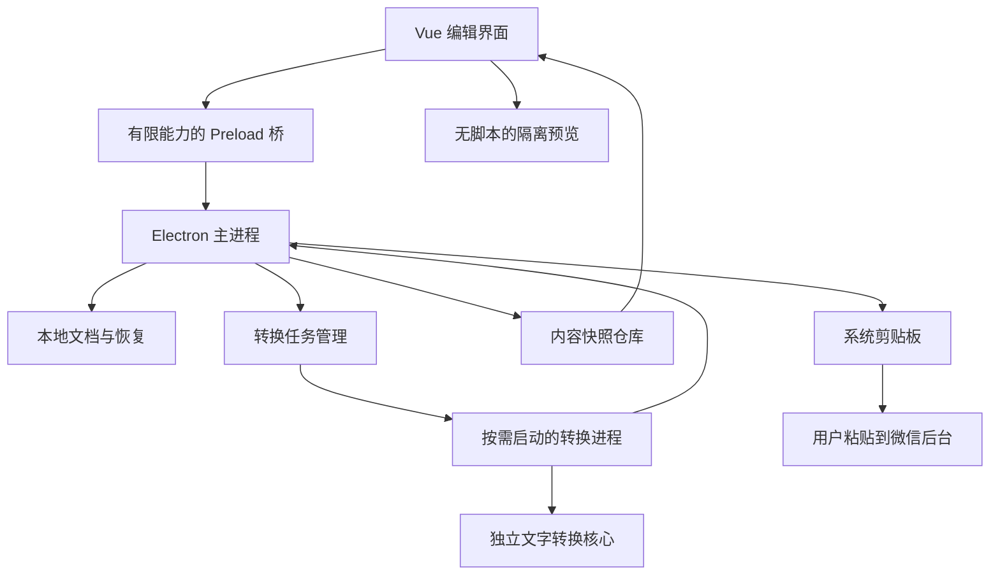

# Electron 技术方案与项目结构设计

> 2026-10-22 实现调整：图片直接输出为 img，本地文件在转换进程中校验格式并嵌入，网络图片保留 HTTP(S) 地址；只有视频生成占位。下文图片占位和禁止图片读取的旧设计已被此规则替代；当前使用说明与验证入口见 README。

> 状态：文档设计，尚未初始化工程或编写业务代码。
>
> 更新日期：2026-10-21。
>
> 已确认：Electron 桌面应用；仅处理文字排版；图片输出“TODO： 图片文件名”；一键复制到系统剪贴板；用户在微信后台审核、微调和处理图片。
>
> 本文中的目录、文件、模块、依赖和测试均为拟建方案，不表示已经创建或实现。
>
> 关联规范：[微信公众号支持标签格式全景指南](./微信公众号支持标签格式全景指南.md)。

## 目录

1. [目标与范围](#一目标与范围)
2. [技术选型](#二技术选型)
3. [总体结构与进程职责](#三总体结构与进程职责)
4. [建议项目目录](#四建议项目目录)
5. [模块边界与依赖规则](#五模块边界与依赖规则)
6. [数据模型与内容快照](#六数据模型与内容快照)
7. [文字转换管线](#七文字转换管线)
8. [图片占位与无图片访问约束](#八图片占位与无图片访问约束)
9. [主题与预览](#九主题与预览)
10. [一键复制与状态一致性](#十一键复制与状态一致性)
11. [IPC 与进程安全](#十一ipc-与进程安全)
12. [本地文件与草稿](#十二本地文件与草稿)
13. [界面与操作流程](#十三界面与操作流程)
14. [错误、性能与恢复](#十四错误性能与恢复)
15. [测试与微信验收](#十五测试与微信验收)
16. [打包与版本管理](#十六打包与版本管理)
17. [实施阶段与完成标准](#十七实施阶段与完成标准)
18. [决策依据](#十八决策依据)

## 一、目标与范围

### 1. 使用流程

导入或编辑 Markdown，选择文字主题，在本地兼容预览中检查结果，点击“复制到公众号”，再由用户粘贴到微信后台审核和微调。

软件的交付边界是系统剪贴板。用户负责微信后台中的图片插入、文章字段、保存、手机预览与发布。

### 2. 第一版目标

| 能力 | 设计范围 |
| --- | --- |
| Markdown 输入 | 文件打开、直接粘贴、编辑、本地保存 |
| 文字排版 | 标题、正文、强调、引用、列表、代码、表格、脚注、链接和提示块 |
| 图片 | 只静态解析引用，生成文件名占位 |
| 公式与图表 | 保留可读源码并提示人工审核，不渲染成图片 |
| 预览 | 与复制结果共享内容快照，提供参考宽度 |
| 一键复制 | 同时写入 HTML 富文本与纯文本 |
| 诊断 | 定位转换、降级和人工审核项；常规提示不要求额外确认 |
| 本地恢复 | 自动保存工作副本与异常退出恢复 |
| 离线 | 核心编辑、转换、预览、复制全部可离线运行 |

不实现图片访问、图片编辑、图床、微信登录、账号管理、微信 API、草稿同步、自动发布或群发。目录中不为这些功能建立空服务或占位入口。

### 3. 核心成功标准

- 文字没有静默丢失，阅读顺序与语义保持。
- 图片占位在预览、HTML 与纯文本中一致。
- 预览和复制基于同一文档修订、主题和兼容规则。
- 复制结果不依赖软件界面的 CSS、脚本、字体下载或资源服务。
- 不把“已写入剪贴板”显示成“微信已经保存”。
- 微信端效果经过样稿验证；未验证能力明确标记。

## 二、技术选型

Electron 已由用户确认；其余为本设计建议。正式实现时选择互相兼容的受支持版本，并通过锁文件固定，不在设计阶段编造版本号。

| 层次 | 选择 | 理由与边界 |
| --- | --- | --- |
| 桌面运行时 | Electron | 统一应用内 Chromium 环境，支持本地文件和富文本剪贴板 |
| 语言 | TypeScript | 约束转换节点、IPC 消息、主题与诊断 |
| UI | Vue 3 | 负责编辑与交互，不直接实现转换规则 |
| 构建 | electron-vite + Vite | 管理 main、preload、renderer 与独立编译入口 |
| 编辑器 | CodeMirror 6 | Markdown 编辑、源位置定位、中文输入与大文档体验 |
| Markdown | unified、remark-parse、remark-gfm | 使用语法树处理语义，减少字符串拼接 |
| 明确扩展 | remark-frontmatter、remark-math 及自有提示块转换 | Front Matter 与公式只解析，不执行；Mermaid 保持代码块 |
| HTML AST | remark-rehype、rehype 工具链 | 结构转换、清洗、检查与最终序列化 |
| HTML 静态解析 | parse5 | 只识别图片与有限静态标记，不挂载 DOM 或加载资源 |
| 样式内联 | Juice | 内联项目生成的有限主题规则，不加载远程资源 |
| CSS 检查 | css-tree | 按属性和值检查，不能只用字符串黑名单 |
| 代码高亮 | Shiki | 输出可选择文字与行内颜色；按需加载打包内的语言 |
| 运行时校验 | Zod | IPC、主题、配置和持久化数据的结构校验 |
| Front Matter 数据 | yaml 的受限解析模式 | 限制别名与复杂度，不执行自定义标签；字段白名单 |
| 本地存储 | Markdown + 版本化 JSON | 单机工作区先保持简单，不引入数据库 |
| 单元/集成测试 | Vitest | 验证转换、占位、清洗与快照契约 |
| 桌面端测试 | Playwright 的 Electron 能力 | 固定版本并封装适配；该能力仍需关注实验性与兼容变化 |
| 安装包 | electron-builder | 首发 Windows 安装包，后续按需求扩展系统 |

不同时引入 markdown-it 作为第二套解析引擎；不引入 Tiptap/ProseMirror 等双向富文本编辑器。Markdown 是内容源，右侧预览只读，最终人工微调在微信后台完成。

第一版使用 Vue 组合式状态即可；有实际跨窗口或复杂状态需求时再评估状态库。采用单仓单应用，不预先拆 monorepo。

不引入 MathJax、KaTeX、Mermaid 运行时、Puppeteer、图片解码库、图床 SDK 或后端框架。识别公式和图表源码不需要运行这些引擎。

## 三、总体结构与进程职责



### 1. 主进程

负责窗口生命周期、文件对话框、明确授权的 Markdown 文件读写、本地恢复、任务管理、快照管理、协议化 IPC 与剪贴板写入。

主进程不做长时间同步解析或高亮，不在主线程执行整篇文章的 CPU 密集转换。

### 2. Preload

只暴露明确的文档、转换和复制能力；不暴露任意 IPC 通道、文件系统、shell、require 或完整 Electron 对象。

预览窗口不复用拥有应用权限的 preload。

### 3. 应用渲染进程

负责编辑器、主题参数、诊断列表、预览外壳和操作状态。不能直接读文件、访问系统剪贴板或调用任意系统命令。

不把 Markdown 或原始 HTML 直接挂到应用 DOM 中。

### 4. 转换进程

建议采用一个按需启动的 utilityProcess，集中承载解析、代码高亮、样式内联与检查。初期单任务顺序执行，优先取消过期任务，不建立进程池。

由主进程传入文本和受控配置，返回可序列化结果。转换器不需要文件系统或网络业务接口；utilityProcess 是 Node 子进程，不将它误称为天然的权限沙箱。

超时或异常时由主进程终止、重建，用户源文与本地工作副本不受影响。[Electron utilityProcess](https://www.electronjs.org/docs/latest/api/utility-process)

### 5. 预览文档

使用无脚本 sandbox iframe 承载经过检查的内容，只有安全的文档壳与内联样式。不给 allow-scripts 或 allow-same-origin，不给应用 preload，不允许加载图片或其他外部资源。

iframe 填充已知尺寸的预览区域，自身滚动；不为测量内容高度而开放脚本或同源权限。

## 四、建议项目目录

以下只是规划树，本轮不实际创建这些目录、配置或源文件。

```text
md2wechatmp/
├─ docs/
│  ├─ 微信公众号支持标签格式全景指南.md
│  └─ Electron技术方案与项目结构设计.md
├─ src/
│  ├─ main/
│  │  ├─ index.ts                  应用入口与生命周期
│  │  ├─ windows/                  主窗口、导航与权限设置
│  │  ├─ ipc/                      消息注册、来源校验、错误映射
│  │  ├─ services/
│  │  │  ├─ document-service.ts     打开、保存与工作副本
│  │  │  ├─ compile-service.ts      调度、取消和版本一致性
│  │  │  └─ clipboard-service.ts    唯一系统剪贴板出口
│  │  ├─ jobs/                     转换进程、超时与崩溃恢复
│  │  └─ repositories/             本地草稿、设置、快照仓库
│  ├─ preload/
│  │  ├─ index.ts                  仅桥接公开能力
│  │  └─ bridge.ts                 类型与订阅生命周期
│  ├─ worker/
│  │  ├─ index.ts                  转换进程入口
│  │  └─ compile-handler.ts        校验消息并调用转换器
│  ├─ converter/
│  │  ├─ pipeline/                 管线编排与各阶段结果
│  │  ├─ parse/                    Markdown 与受限 HTML 解析
│  │  ├─ normalize/                语义规范化与源位置保留
│  │  ├─ transforms/
│  │  │  ├─ image-placeholder.ts   文件名提取与文字占位
│  │  │  ├─ links.ts               文末链接引用
│  │  │  ├─ footnotes.ts           脚注与编号
│  │  │  ├─ lists.ts               列表与静态任务符号
│  │  │  ├─ tables.ts              表格及文字降级
│  │  │  ├─ callouts.ts            静态提示块
│  │  │  └─ source-blocks.ts       公式与图表源码保留
│  │  ├─ highlight/                Shiki 与纯文本回退
│  │  ├─ html/                     HAST 结构与受控节点生成
│  │  ├─ styles/                   主题展开、内联、CSS 值检查
│  │  ├─ sanitize/                 结构和属性清洗
│  │  ├─ validate/                 输出不变量与诊断
│  │  └─ serialize/                HTML 片段与纯文本
│  ├─ themes/
│  │  ├─ schema.ts                 主题字段与参数边界
│  │  ├─ builtins/                 内置主题数据
│  │  └─ compatibility/            基线规则与实测记录
│  ├─ renderer/
│  │  ├─ index.html                可信应用页面入口
│  │  ├─ main.ts                   Vue 启动
│  │  ├─ App.vue                   应用骨架
│  │  ├─ features/
│  │  │  ├─ documents/             文档与本地草稿操作
│  │  │  ├─ editor/                CodeMirror 与中文输入
│  │  │  ├─ preview/               只读 iframe 与宽度选择
│  │  │  ├─ theme/                 主题选择与有限参数
│  │  │  ├─ diagnostics/           提示、计数与源码定位
│  │  │  └─ clipboard/             复制按钮与状态
│  │  ├─ state/                   当前文档、修订和操作状态
│  │  ├─ components/              通用界面组件
│  │  └─ styles/                  只影响应用界面的 CSS
│  └─ shared/
│     ├─ contracts/               IPC 与转换消息
│     ├─ models/                  文档、快照、主题、诊断
│     ├─ schemas/                 运行时校验
│     ├─ errors/                  稳定错误标识
│     └─ versions/                数据与兼容规则版本
├─ tests/
│  ├─ fixtures/                   Markdown、预期文字与规则案例
│  ├─ unit/                       语义与占位规则
│  ├─ integration/                全管线、剪贴板适配、本地恢复
│  ├─ electron/                   桌面操作与隔离检查
│  └─ compatibility/              微信人工验收记录与证据
├─ build/
│  └─ icons/                      应用图标，非文章图片资源
├─ electron.vite.config.ts        拟建构建配置
├─ electron-builder.yml          拟建安装包配置
├─ package.json                  拟建依赖与命令入口
├─ package-lock.json             采用 npm 后生成的唯一锁文件
├─ tsconfig.json                 拟建公共 TypeScript 设置
└─ README.md                     拟建使用与开发说明
```

构建输出和安装包放入独立的忽略目录，不提交；用户数据写在应用数据目录，不写到源码树或安装目录。

## 五、模块边界与依赖规则

| 模块 | 可以依赖 | 不允许依赖 |
| --- | --- | --- |
| shared | 通用数据与校验库 | Electron、Vue、系统 IO |
| themes | shared | 窗口、剪贴板、网络 |
| converter | shared、themes、解析/高亮/CSS 库 | Electron、Vue、文件读取、网络与微信 SDK |
| worker | converter、shared | UI、任意用户脚本、外部资源服务 |
| main | shared、任务与持久化适配器 | Vue 组件、界面 CSS |
| preload | shared、有限 Electron 桥接 | 转换业务、任意路径读写、任意通道透传 |
| renderer | shared、Vue、CodeMirror、公开桥接 | Electron 和 Node 内建模块 |
| preview | 已验证 HTML 与安全壳 | 应用权限、运行脚本和外部资源 |

UI 不决定图片命名、链接编号或 HTML 标签；这些规则只有 converter 一份实现。

样式清洗不是只调用一个通用库就结束。结构清洗采用显式 schema；style 属性由独立 CSS 规则检查后保留，不能简单开放全部 style，也不能用默认配置把所需样式全部误删。

不建立图床服务、图片资产库、微信客户端或发布调度模块。

## 六、数据模型与内容快照

### 1. 领域对象

| 对象 | 必要信息 |
| --- | --- |
| Document | 文档 ID、Markdown 源文、修订号、本地文件句柄标识、修改状态 |
| ArticleMetadata | 可选标题、作者、摘要；只供本地管理，不写微信字段 |
| ThemeProfile | 主题 ID、版本、允许的参数 |
| CompatibilityProfile | 输出规则版本、基线/实验开关和验证状态 |
| CompileRequest | 文档 ID、源文修订、主题摘要、规则版本、任务 ID |
| PlaceholderRecord | 图片序号、显示文件名、源位置、提取结果；不含图片字节 |
| LinkReference | 原始链接的受控表示、文末编号、源位置 |
| Diagnostic | 标识、等级、原因、源位置、采取的动作、审核建议 |
| ContentSnapshot | HTML 片段、纯文本、占位清单、诊断、生成版本信息与统计 |

文件句柄标识是主进程管理的逻辑引用，不是任意路径读写许可。

### 2. 语法树选择

使用 mdast 表达 Markdown 语义，转换到 HAST 后构建受控 HTML。借助源位置与节点标识追踪诊断，不再发明覆盖全部 Markdown 的第二套完整 AST。

在进入 HTML 之前完成图片占位和不可执行内容转换。保留公式、图表源文所需的原文切片，避免重序列化时改变定界符或缩进。

### 3. 快照不变量

一次转换生成一个不可变快照，至少绑定：

- 文档 ID、源文修订与源文摘要。
- 主题 ID/版本及参数摘要。
- 兼容规则、转换器版本。
- 清洗后的 HTML 片段、同语义纯文本和诊断。
- 图片占位数、人工审核项数、字符/字节统计。

不能只以 Markdown 文本为缓存键；主题和规则变化也要使旧结果失效。不把微信 API 的字符限制用作当前复制功能的硬阈值。

快照只含文字富文本，不含图像、资源下载清单、账号凭据或上传状态。

## 七、文字转换管线

| 阶段 | 输入与职责 | 产物 |
| --- | --- | --- |
| 1. 校验 | 文本大小、配置结构、当前修订 | 有效请求或可定位错误 |
| 2. 解析 | CommonMark/GFM 与明确扩展 | 带源位置的 mdast |
| 3. 元数据 | 受限 Front Matter 提取 | 正文与本地元数据 |
| 4. 规范化 | 换行、列表、引用、提示块 | 一致的语义结构 |
| 5. 图片占位 | 静态提取文件名，替换图片节点 | 普通文本节点与占位记录 |
| 6. 引用与源码块 | 链接、脚注编号；公式图表保留源码 | 明确的文字交付结构 |
| 7. 高亮 | 已允许语言的代码文本高亮 | token 级文字节点，失败则纯文本 |
| 8. 构造 HTML | mdast 到 HAST，再应用微信结构规则 | 受控文章节点 |
| 9. 应用主题 | 有限参数展开为主题 CSS | 内部主题规则 |
| 10. 内联 | Juice 仅处理内存中的受控内容 | 行内样式 HTML |
| 11. 清洗检查 | 结构、属性、CSS、协议与内容不变量 | 安全片段与诊断 |
| 12. 序列化 | 相同语义结果生成 HTML 与纯文本 | 不可变内容快照 |

补充约束：

- 原始 HTML 在任何 DOM 挂载前进行静态解析和处理；不经过“先渲染再清洗”。
- 链接引用与脚注使用独立标识，例如“链接 1”与“注 1”，避免编号含义冲突。
- 行内代码、代码围栏内的图片/链接语法不参与正文规则。
- 纯文本从已规范化语义生成，不用正则删 HTML 得到；保留段落、列表编号、代码缩进和占位。
- 链接文字、占位和必要分隔符均为真实节点，不依赖伪元素。
- 用户内容不能修改插件集合、注入运行时代码或指定任意模块路径。

## 八、图片占位与无图片访问约束

统一格式：**TODO： 图片文件名**。详细边界遵循格式指南第四章。

| 问题 | 决策 |
| --- | --- |
| 相对路径以哪个目录读取图片 | 不读取；只解析引用中的文件名 |
| 文件不存在 | 不检查，不因此报错 |
| 远程 URL 是否下载 | 不下载，不做 HEAD 请求或链接探活 |
| 图片是否显示缩略图 | 不显示 |
| 查询串是否进入占位 | 不进入，避免把 token 等内容写入文章 |
| 文件名是否去重 | 不去重，保持每个位置 |
| 未命名图片 | 按全文图片顺序生成可识别名称 |
| 内联图片、SVG | 静态识别为占位，不解码/执行 |
| 图片 alt | 不覆盖已存在文件名；仅保留内部说明 |
| 用户在代码块写图片语法 | 保持代码文字，不替换 |
| 粘贴图片二进制 | 不接收为图片编辑能力；提示使用 Markdown 图片引用或直接在微信处理 |
| 图片上传/API | 无模块、无配置、无账号入口 |

无 IO 是可测试契约：converter 不注入文件或网络适配器，测试用不可访问的路径和地址照常生成占位。应用只读取用户选择的文本文件，不遍历图片目录。

HTML img、picture、SVG 的识别使用受限静态解析。输入中任何图片地址都不能进入预览文档的加载属性。

## 九、主题与预览

### 1. 主题参数

第一版内置少量文字主题，以参数化差异实现，不开放任意 CSS 编辑或在线主题下载。

| 参数组 | 范围 |
| --- | --- |
| 字体 | 系统无衬线与等宽回退栈 |
| 正文 | 字号、行高、字距、段落间距、可选首行缩进 |
| 标题 | 分级字号、字重、颜色、上下间距 |
| 引用与提示 | 边框、内边距、前景与背景 |
| 代码 | 字号、行高、高亮主题、长行策略 |
| 列表 | 缩进、项目间距、静态符号策略 |
| 表格 | 边框、单元格内边距、表头样式与文字降级选项 |

初始候选可使用约 16px 正文与 1.75 行高、较小等宽代码字体；这是主题试验起点，不是微信官方标准。通过样稿验收后再锁定默认值。

主题不包含背景图片、远程字体、脚本、任意 URL 或账号相关字段。

### 2. 预览一致性

- iframe 内容来自 ContentSnapshot 的 HTML；外层只增加 CSP、默认背景和安全文档壳。
- 复制片段不包含 iframe、CSP 文档头、软件工具栏或外层参考宽度。
- 320/375/430 CSS px 是预览参考宽度，不宣称模拟特定手机。
- 应用浅深色主题与文章主题分开；深色参考只能帮助检查对比度，不模拟微信完整转换算法。
- 不在预览中开放编辑，以免产生 Markdown 与 DOM 双内容源。
- 源文、主题或规则变化会使当前快照过期，界面显示“正在更新”，不继续标记为最新。
- 图片占位就是文章内文字；诊断图标、计数和高亮浮层留在 iframe 外，不进入复制结果。

## 十、一键复制与状态一致性

### 1. 用户动作

“复制到公众号”是常规主操作。正常情况下点击一次即可完成，不要求账号授权或额外确认。

按点击时的当前文档、源文修订和主题创建复制请求：

1. 有匹配且检查通过的快照时立即提交主进程。
2. 正在转换时等待该修订的有效快照，按钮显示进度。
3. 等待期间源文、主题或文档发生变化则取消该复制请求，避免误复制旧内容；给出简短状态，允许再次点击。
4. 写入前主进程再次校验快照标识、当前修订和是否存在阻断错误。
5. 主进程写入 HTML 与纯文本；成功后提示“已复制，请到微信后台粘贴并审核”。
6. 复制后的继续编辑使“已复制”状态失效，但不会自动改写系统剪贴板。

重复点击合并或替换尚未完成的复制请求，不能形成一串延迟写入。

### 2. 剪贴板边界

| 项目 | 契约 |
| --- | --- |
| 富文本 | 仅清洗后的文章 HTML 片段 |
| 纯文本 | 相同语义文字，包含所有图片占位和引用 |
| 接口位置 | 只在主进程适配层 |
| IPC 输入 | 快照 ID 与期望修订，不接受任意 HTML 直接写入 |
| 系统格式 | 优先依赖选定 Electron 版本对 text/html 和原生格式的支持 |
| 成功条件 | 系统剪贴板写入完成，不等于微信接受或保存 |
| 失败处理 | 不静默只写纯文本却提示富文本成功；明确原因和重试入口 |
| 其他内容 | 不复制选中 UI、诊断列表、路径或调试信息 |

生产功能不读取剪贴板历史；集成测试可对本次写入做回读验证。

### 3. 不阻断的提示

图片占位、外链转引用、公式图表源码保留等是已知工作流，不逐项弹确认框。复制成功后可显示“包含 N 个图片占位、M 个审核提示”。

只有转换失败、快照过期、清洗检查不通过或剪贴板写入失败才阻止对应成功状态。

## 十一、IPC 与进程安全

### 1. 有限能力接口

下表是契约设计，不是已实现函数。

| 能力 | 主要输入 | 结果 |
| --- | --- | --- |
| 打开 Markdown | 文件对话框操作 | 文档 ID、文本、受控本地标识 |
| 更新源文 | 文档 ID、当前修订、文本 | 新修订与本地工作副本状态 |
| 保存 / 另存为 | 文档 ID、修订 | 保存结果与修改状态 |
| 请求转换 | 文档 ID、修订、主题与规则摘要 | 任务 ID |
| 订阅转换 | 文档/任务标识 | 进度、快照或诊断 |
| 取消转换 | 当前任务 ID | 已取消或任务已结束 |
| 请求复制 | 快照 ID、期望修订 | 系统写入结果 |
| 本地设置 | 允许的设置字段 | 已验证设置 |

所有请求在主进程与转换入口做运行时结构校验，校验来源 frame、负载大小和文档归属。不能让渲染进程传入任意通道名、命令、模块名或文件路径获得系统权限。

取消订阅与窗口销毁必须释放监听器，避免重复事件。

### 2. 内容隔离

- 应用窗口开启 contextIsolation、关闭 nodeIntegration，并采用受支持的 sandbox 配置。
- preload 只桥接公开能力；不向内容预览暴露能力。
- 预览 CSP 默认禁止所有外部资源与脚本，只允许必要的内联样式；禁止图片、字体下载、连接、表单与导航。
- 阻止应用窗口和预览内容的任意导航、新窗口和权限请求。
- 不通过执行用户 HTML、动态 import 或 eval 解析扩展。
- 清洗规则不能为了显示效果开放所有标签或所有 style。
- 日志不记录全文、完整本地路径、data URL 和 URL 查询串；诊断以源位置与安全显示名为主。
- 本轮设计不引入自动联网或遥测。

这些规则服务于本工具处理不可信 Markdown/HTML 的实际边界。[Electron 安全指南](https://www.electronjs.org/docs/latest/tutorial/security)

## 十二、本地文件与草稿

### 1. 用户源文件

- 打开 .md、.markdown，必要时允许用户明确选择纯文本文件。
- 默认 UTF-8；无法解码时提示编码问题，不以乱码覆盖源文件。
- 主进程保存已打开文件的受控路径；图片引用只作为字符串保留。
- 编辑不自动覆盖原文件。自动保存的是应用工作副本，用户显式保存才更新源文件。
- 源文件被外部修改时比较修改时间与内容摘要，先提供重新载入或另存为，不能静默覆盖。
- 保存采用同目录临时文件与替换策略，处理失败和备份；实现时按 Windows 实际文件语义验证。

### 2. 应用数据

拟放在 Electron userData 下的专用子目录：

| 数据 | 形式 | 策略 |
| --- | --- | --- |
| 本地草稿 | Markdown 源文 + 版本化元数据 JSON | 原子提交、可恢复 |
| 用户设置 | 版本化 JSON | 有默认值、迁移和损坏回退 |
| 内置主题 | 打包资源 | 不在用户编辑时覆盖程序资源 |
| 用户主题参数 | 受限 JSON | 校验参数，不执行任意 CSS |
| 内容快照 | 有上限的内存缓存 | 可重建，不作为唯一内容来源 |
| 恢复记录 | 最后成功工作副本与必要备份 | 提供恢复入口，不静默丢稿 |
| 日志 | 有大小与数量上限的轮转文本 | 不存正文和敏感地址 |

缓存和本地草稿分开清理。清缓存不能删除用户草稿。删除草稿、覆盖源文属于单独的用户操作，不混入转换流程。

### 3. 内容源与交付

文章交付只采用一键复制，源文管理提供 Markdown 保存。当前不建立 HTML 文件导出、图片目录、上传服务或其他交付出口。

本地源文中的原始图片引用仍然保留，只有转换结果使用 TODO 占位。不能为了占位而改写用户 Markdown 源文。

## 十三、界面与操作流程

### 1. 页面构成

| 区域 | 内容 |
| --- | --- |
| 顶部操作区 | 打开、保存、主题、复制到公众号 |
| 左侧编辑区 | Markdown 源文、行号、查找与诊断定位 |
| 右侧预览区 | 只读文字排版、参考宽度 |
| 状态/提示区 | 修改状态、转换状态、占位数、审核项数 |
| 可展开诊断区 | 信息、警告、错误与源位置 |

界面不放微信账号登录、图片管理、上传进度、发布按钮或 API 配置。

### 2. 状态设计

| 状态 | 行为 |
| --- | --- |
| 空白文档 | 可编辑或打开文件；空内容复制给出简短提示 |
| 编辑中 | 增加修订，更新本地工作副本并调度转换 |
| 转换中 | 保留上次预览但清楚标为旧结果 |
| 预览就绪 | 可复制当前快照 |
| 存在审核提示 | 仍可复制，显示提示数量 |
| 阻断错误 | 源文不丢失，不能把旧快照作为当前结果复制 |
| 已复制 | 显示对应修订成功；内容变更后清除该状态 |
| 保存失败 | 保留内存与工作副本，提供另存为 |
| 恢复待处理 | 显示可恢复草稿，不覆盖用户刚打开的文件 |

中文输入法组合期间避免强制替换编辑器值或抢焦点；转换不打断输入。诊断定位不修改源文，标题与源文的查找操作也不触发复制。

## 十四、错误、性能与恢复

### 1. 任务控制

- 编辑调度采用短防抖，初始候选约 250ms；中文组合输入按编辑器事件处理。
- 一次只保留当前需要的转换任务与有限快照，快速输入时取消或丢弃过期结果。
- 内容摘要、主题与规则摘要决定缓存有效性。
- 单个代码块失败降为纯文本；未知语法保留原文，不让整篇文章消失。
- 转换进程失联或超时后终止重建，返回稳定错误标识。
- 图片不参与 IO，所以图片路径无效不应造成等待、重试或网络错误。

### 2. 性能指标

正式阈值在实现后基于固定设备和样稿测量，不先宣称达到未测性能。

| 评估项 | 验证方式 |
| --- | --- |
| 常规文章编辑响应 | 编辑与转换分离，记录输入卡顿和完成时间 |
| 大量代码块 | 语言按需加载，检查内存与高亮降级 |
| 大量链接和占位 | 检查编号与文件名提取是否线性、是否存在重复扫描 |
| 超大输入 | 明确大小与复杂度限制，提示用户处理，不无期限挂起 |
| 快速切换主题 | 只提交最新匹配快照 |
| 长时间使用 | 缓存、订阅和任务数量有上限，无持续增长 |

第一阶段先选小、中、大三档固定文字样稿建立基线，再记录可接受的时间和内存预算。没有数据时只记录目标，不写成完成结果。

## 十五、测试与微信验收

### 1. 自动验证

| 层次 | 重点 |
| --- | --- |
| 转换单元 | Markdown 语义、列表编号、脚注、链接、代码空白、未知语法 |
| 图片占位 | Windows/Unix 路径、中文空格、编码、查询串、data URL、参考式、HTML、SVG、重复图 |
| 无图片 IO | 不存在的路径和不可达地址仍完成占位；没有文件/网络访问 |
| 清洗检查 | 不执行原始 HTML；最终无图像、脚本、事件、资源 URL 和未解析 CSS 变量 |
| 完整管线 | HTML 与纯文本的语义、占位数量和顺序一致 |
| 并发状态 | 快速输入、主题切换、跨文档、过期快照、重复复制 |
| IPC | 非法来源、无效负载、未知文档/快照、任意路径和通道不能获得权限 |
| 剪贴板 | HTML/纯文本同次写入、回读一致、失败提示正确 |
| 本地恢复 | 原子保存中断、损坏设置、外部改动、草稿恢复 |
| 桌面冒烟 | 中文输入、打开保存、预览、复制、离线启动和安装后资源路径 |

测试以能发现语义丢失、权限泄漏和错误复制为目标，不只保存大量 HTML 字符串快照。主题视觉变化可以有少量基准截图，但截图不能代替语义断言。

### 2. 微信人工验证

沿用格式指南第十一章样稿，按以下顺序记录：

1. 从正式打包的 Windows 应用复制。
2. 在 Chrome、Edge 微信后台分别粘贴。
3. 由用户保存草稿后重开。
4. 在 iOS、Android 微信中预览浅色、深色与放大字体。
5. 记录文字、列表、代码、表格、占位与引用的变化及降级方案。

软件不自动操作登录账号或调用微信接口。需要用户配合的验收项标为待验证，不能在本地检查通过后改成“微信兼容完成”。

### 3. 发布门槛

必须满足当前范围内的语义、占位、隔离、复制和本地恢复检查。某个实验布局未通过时关闭该布局，不通过隐藏诊断伪装成全格式支持。

## 十六、打包与版本管理

- Windows 首发；具体最低系统版本在选定 Electron 版本后按其官方支持范围确定。
- 采用 electron-vite 构建主进程、preload、renderer 与转换进程入口；验证打包后 worker、Shiki 语言及主题资源路径。
- electron-builder 生成 Windows 安装包；代码签名和安装体验在交付前单独验证，不声称未签名包没有系统提示。
- 第一版不增加自动更新服务；升级前保护本地草稿，数据迁移有版本和回退策略。
- npm 与 package-lock 作为建议的单一依赖管理方式；不同时提交多种锁文件。
- Electron 选择官方支持中的稳定版本；升级重新检查剪贴板、sandbox、打包和转换依赖。
- 区分应用版本、转换器版本、主题版本、兼容规则版本与本地数据版本。
- 核心运行不访问 CDN，解析器、高亮语言和主题随应用打包。
- 后续确需 macOS 或 Linux 时，补对应剪贴板与字体验证，不只重新生成安装包。

[electron-vite 文档](https://electron-vite.org/guide/)、[electron-builder](https://www.electron.build/)、[Electron 版本支持](https://www.electronjs.org/docs/latest/tutorial/electron-timelines)。

## 十七、实施阶段与完成标准

| 阶段 | 交付 | 完成标准 |
| --- | --- | --- |
| 当前：文档设计 | 两份 docs 文档 | 范围一致，无代码、配置或安装依赖 |
| 阶段 1：核心样稿验证 | 独立转换核心、基线主题、剪贴板验证 | 图片占位准确，文字不丢失，微信粘贴关键样稿可审核 |
| 阶段 2：桌面闭环 | 编辑、预览、复制与诊断 | 正常一键复制，无过期结果，中文输入稳定 |
| 阶段 3：本地可靠性 | 保存、恢复、取消与错误处理 | 不覆盖用户源文，不因转换失败丢稿 |
| 阶段 4：兼容与安装 | 微信矩阵记录、正式安装包 | 标清已验证能力与剩余限制 |

阶段 1 优先验证最有风险的链路：代码空白、列表序号、表格、内联样式和系统富文本复制。不能先堆界面，再发现核心样稿粘贴失败。

图片、API 和自动发布不会作为这些阶段的隐含任务。未来只有用户明确改变范围，才重新设计相关能力。

## 十八、决策依据

资料最后核对日期：2026-10-21。资料说明组件能力，不等于证明本项目已经实现。

| 资料 | 对应决策 |
| --- | --- |
| [Electron 简介](https://www.electronjs.org/docs/latest/) | 桌面运行时与 Chromium/Node.js |
| [Electron Clipboard](https://www.electronjs.org/docs/latest/api/clipboard) | 主进程系统剪贴板适配 |
| [Electron utilityProcess](https://www.electronjs.org/docs/latest/api/utility-process) | 独立转换任务进程 |
| [Electron 安全指南](https://www.electronjs.org/docs/latest/tutorial/security) | preload、sandbox、不可信内容隔离 |
| [Electron 自动化测试](https://www.electronjs.org/docs/latest/tutorial/automated-testing) | 桌面端测试与框架适配 |
| [electron-vite](https://electron-vite.org/guide/) | 多入口构建与开发 |
| [electron-builder](https://www.electron.build/) | 安装包 |
| [remark](https://github.com/remarkjs/remark)、[remark-gfm](https://github.com/remarkjs/remark-gfm)、[remark-rehype](https://github.com/remarkjs/remark-rehype) | 语法树转换 |
| [remark-frontmatter](https://github.com/remarkjs/remark-frontmatter)、[remark-math](https://github.com/remarkjs/remark-math) | 解析明确扩展，不引入执行或图像渲染 |
| [parse5](https://github.com/inikulin/parse5) | 静态 HTML 解析 |
| [rehype-sanitize](https://github.com/rehypejs/rehype-sanitize) | 显式结构清洗，结合独立 CSS 检查 |
| [Playwright Electron](https://playwright.dev/docs/api/class-electron) | 实验性桌面测试适配 |
| [Juice](https://github.com/Automattic/juice) | 样式内联 |
| [Shiki](https://shiki.style/guide/install) | 保留文字的代码高亮 |

后续实施以本文确认的“文字转换、图片占位、一键复制、人工审核”为范围。新增功能先更新两份文档的边界与验收条件，再开始实现。

