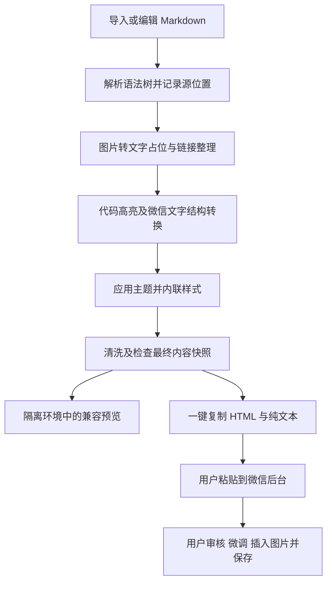

# 微信公众号支持标签格式与排版规范全景指南

> 2026-10-22 实现调整：图片直接输出为安全的 img（本地图片嵌入、网络图片保留 HTTP(S) 地址），只有视频继续使用占位。下文关于“图片占位/不读取或预览图片”的旧设计已被此规则替代；当前行为与测试入口见 README。尚未进行真实微信后台的粘贴保存验证。

> 文档性质：md2wechatmp 项目的格式清单、转换策略与兼容性验证规范，不是微信官方完整白名单或官方白皮书。
>
> 更新日期：2026-10-21。
>
> 已确认范围：只转换文字排版；图片替换为“TODO： 图片文件名”；一键复制富文本，由用户粘贴到微信公众号后台审核、微调和处理图片。
>
> 不包含：图片读取、下载、预览、转码、上传，微信 API 接入、账号授权、自动保存微信草稿、发布与群发。
>
> 当前状态：设计规范，尚未完成本项目微信粘贴、保存与真机验证。下文“默认输出”是项目决策，不表示已经实测通过。
>
> 关联文档：[Electron 技术方案与项目结构设计](./Electron技术方案与项目结构设计.md)。

## 目录

1. [范围、证据与支持等级](#一范围证据与支持等级)
2. [处理链路与常见失真原因](#二处理链路与常见失真原因)
3. [Markdown 输入格式与转换清单](#三markdown-输入格式与转换清单)
4. [图片占位规范](#四图片占位规范)
5. [HTML 元素与属性处理清单](#五html-元素与属性处理清单)
6. [CSS、字体与移动端排版规则](#六css字体与移动端排版规则)
7. [代码、表格、公式和图表](#七代码表格公式和图表)
8. [链接与微信专用功能](#八链接与微信专用功能)
9. [一键复制与人工审核](#九一键复制与人工审核)
10. [兼容配置、诊断与降级](#十兼容配置诊断与降级)
11. [兼容性验证与验收](#十一兼容性验证与验收)
12. [原指南审查修正记录](#十二原指南审查修正记录)
13. [资料来源与维护](#十三资料来源与维护)

## 一、范围、证据与支持等级

### 1. 本文所说的“完整”

完整是指覆盖本工具需要识别的文字输入格式、默认输出、占位和降级行为、验证方法；不是覆盖 HTML/CSS 全部标准，也不是承诺支持微信所有内部标签。

输入边界以 CommonMark + GFM 为基础，明确处理 Front Matter、提示块、公式和 Mermaid 源码。其他方言必须明确提示，不静默丢失内容。

最终交付是可粘贴的文字富文本。正文、代码、表格尽量保留文字的可选择和可编辑性；不将内容生成图片。

### 2. 区分四个处理阶段

| 阶段 | 可以确认 | 不能据此确认 |
| --- | --- | --- |
| 本地渲染 | 当前 Electron 能呈现内容 | 微信会保留相同结构与样式 |
| 微信后台粘贴 | 当前编辑器暂时接受了片段 | 保存与重新打开后仍一致 |
| 微信草稿保存 | 用户保存后仍保留的内容 | 发布后各设备完全一致 |
| 微信客户端阅读 | 被测系统、版本和显示模式的效果 | 所有设备、后续版本的效果 |

内容可能在剪贴板导入、编辑器规范化、保存和最终阅读等环节发生变化。不能把所有失真笼统归因于同一个服务端过滤器。

本工具只负责本地转换与复制；后两个阶段由用户在微信后台完成。

### 3. 证据等级与输出等级

| 证据等级 | 含义 |
| --- | --- |
| 官方依据 | 对应技术或平台的官方资料明确说明，并记录链接和日期 |
| 项目策略 | 为稳定性与可维护性主动采用的规则，不等于微信官方限制 |
| 已实测 | 在特定环境完成端到端验证，附样稿、环境和结果 |
| 待验证 | 浏览器能力、历史经验或不完整信息，不能作为稳定保证 |

截至更新日，本项目没有“已实测”条目。

| 输出等级 | 含义 |
| --- | --- |
| 基线候选 | 默认采用的简单结构，仍需微信端验收 |
| 转换 | 不原样输出，改成受控文本或静态结构 |
| 实验 | 默认关闭，具备匹配证据后才能启用 |
| 排除 | 不实现相应能力；尽量保留有意义的文字并提示 |

## 二、处理链路与常见失真原因

推荐流程：

常见失真来源：

- 样式依赖 class、外部 CSS、父级继承或 CSS 变量，复制后不再生效。
- 文章预览依赖软件界面样式，而实际复制没有相同样式。
- 复杂嵌套、定位、多列布局在粘贴或保存时被改写。
- 代码空白被折叠，字体替换导致行宽变化。
- 复制的是 HTML 源码字符串，没有写入富文本剪贴板格式。
- 预览与复制使用不同转换器、主题或文档修订。
- 手机字体、字号设置、屏幕宽度与深色模式不同。

预览应称为“兼容预览”，不标为微信最终效果的精确模拟。

## 三、Markdown 输入格式与转换清单

### 1. 基础语法与 GFM

| 输入格式 | 默认输出或行为 | 边界 |
| --- | --- | --- |
| ATX 与 Setext 标题 | 六级受控标题 | 文内一级标题不自动等于微信文章标题 |
| 普通段落 | p 与行内文本节点 | 保留段落边界，不靠空格撑版面 |
| 软换行 | 遵循 CommonMark；另提供明确的换行选项 | 不把编辑器自动折行变成 br |
| 硬换行 | br | 处理行末双空格和反斜杠语法 |
| 空行与分隔线 | 段落边界或受控分割线 | 不生成大量空白段落 |
| 加粗、斜体、删除线 | strong、em、del 或等效 span | 正确处理嵌套、标点和中文 |
| 行内代码 | code 或等效 span | 内容转义，保留原有字符 |
| 围栏与缩进代码 | pre/code 或经验证的等效结构 | 空格、Tab、空行、长行单独处理 |
| 无序、有序列表 | ul/ol/li 候选结构 | 起始编号、混合嵌套与列表内块元素 |
| 紧凑与宽松列表 | 明确的列表段落间距 | 不依赖浏览器默认边距 |
| 引用与嵌套引用 | blockquote 或受控 section | 深层嵌套仍须可读 |
| GFM 任务列表 | 静态 ☑ / ☐ 与列表文字 | 不输出可交互 input |
| GFM 表格 | 简单 table | 对齐下沉到单元格；宽表按第七章处理 |
| 普通与参考式链接 | 统一链接模型后采用文末引用 | 不假定任意外链可点击 |
| 自动链接、裸网址 | 同链接规则 | 长 URL 避免撑破布局 |
| 内联、参考式图片 | “TODO： 图片文件名” | 不访问图片，见第四章 |
| 脚注 | 正文编号与文末脚注文字 | 默认不依赖页内回跳 |
| 转义与字符实体 | 安全文本节点 | 避免重复转义或恢复成可执行 HTML |
| HTML 注释 | 不进入输出 | 需要诊断时保留源位置 |

GFM 解析采用 remark-gfm；其覆盖自动链接、脚注、删除线、表格和任务列表，项目仍需定义对应微信输出。[remark-gfm](https://github.com/remarkjs/remark-gfm)

### 2. 扩展与其他方言

| 输入 | 当前策略 |
| --- | --- |
| YAML Front Matter | 只解析允许的标题、作者、摘要等本地字段，不进入正文；不写入微信后台 |
| GitHub 风格提示块 | 静态标题加正文，转换为受控提示区域 |
| 行内公式 | 保留公式源文与定界符，以可读文字显示，不加载数学字体或生成图片 |
| 块级公式 | 保留公式源码为等宽文本块并提示“请审核公式” |
| Mermaid 围栏 | 保留为普通源码块并提示“请自行处理图表”，不运行 Mermaid |
| 其他图表围栏 | 保留源码，不调用外部渲染服务 |
| 静态目录 | 按标题生成文字清单，可选章节编号，不保证页内跳转 |
| 定义列表 | 后续扩展可转为术语与说明段；未启用时保留原文并提示 |
| 注音 ruby | 有明确输入规则时降为“文字（读音）”；原生注音不是基线 |
| 高亮、上下标等扩展语法 | 只有明确启用的插件才识别；不混称为标准语法 |
| Obsidian 双链、嵌入、Callout、块引用 | 第一版不自动解释；保留原文并提示方言未启用 |
| MDX、可执行代码块、模板指令 | 不执行；保留文本或提示不支持 |
| 未知代码语言 | 普通代码块；内容不能丢失 |
| 其他未知扩展 | 保留原文，报告位置，不猜测其含义 |

公式、图表源码可进入复制结果，但属于人工审核项；不能将“源码已保留”显示为“公式图表已排版完成”。

### 3. 原始 HTML

默认不允许任意 HTML 原样穿透。仅处理明确的静态行内语义，例如 br、sub、sup、u；图片标记单独转为占位文字。

其他原始 HTML 默认转义显示并提示。若存在结构化导入需求，应先解析和清洗再重建；不能用正则替换充当完整 HTML 解析器。清洗前也不得把原始 HTML 挂载到可见 DOM。

## 四、图片占位规范

### 1. 唯一目标

所有被识别的图片节点转换为普通文字：

**TODO： 图片文件名**

冒号使用全角“：”，冒号后保留一个普通空格。占位是复制结果中的真实文字，不是应用界面的浮层、伪元素或只在预览中可见的提示。

不读取文件、不探测存在性、不请求远程地址、不查看尺寸、不建立图床或图片缓存。用户自行在微信后台删除或替换占位并插入图片。

### 2. 文件名提取

| 输入 | 占位结果 |
| --- | --- |
| 相对路径 images/示意图.png | TODO： 示意图.png |
| Windows 路径 C:\\资料\\图片\\架构图.jpg | TODO： 架构图.jpg |
| 网络地址 https://example.com/a/chart.png?token=xxx#part | TODO： chart.png |
| 编码文件名 %E6%9E%B6%E6%9E%84%E5%9B%BE.png | TODO： 架构图.png |
| 参考式图片，定义指向 figures/result.webp | TODO： result.webp |
| 行内图片“见图片节点后的说明” | 在原位置插入占位文字，保留前后句子 |
| 没有可提取文件名 | TODO： 未命名图片-001 |
| data URL 图片 | TODO： 内嵌图片-001 |
| 无文件名的内联 SVG | TODO： 内联图片-001 |

提取规则：

1. 本地路径兼容正斜杠和反斜杠；只保留文件名，不输出完整机器路径。
2. URL/URI 引用去掉查询串与片段；不把签名、token 或整段 data URL 写进占位或诊断。
3. 对可解码的文件名最多做一次百分号解码；失败时保留安全的可见名称并提示。
4. 解码后再次去除路径分隔信息，换行、控制字符等规范化为空格，结果始终作为文字转义。
5. 保留中文、空格、扩展名及同名图片出现次数，不自动改名或去重。
6. 无名称的图片按全文图片出现顺序生成三位编号；编号宽度可随总数增长，不截断。
7. 图片 alt 与 title 可留在内部源信息，不替代已存在的文件名，不默认追加到文章中。
8. 无法解析的参考式图片不能静默消失；保留原文并提示定义缺失。

### 3. 位置与结构

- 仅图片构成的段落输出一个普通占位段落。
- 行内图片在相同位置输出占位文字，不额外拆断整个句子。
- 同一段内多张图片按原顺序保留各自占位；连续图片段落不合并。
- 链接包裹图片时保留图片占位，不把该图片链接另加为文末引用；给出转换信息。
- 图片位于列表、引用或表格中时，保留所属结构。
- 引用式图片节点正常解析后占位；定义行不重复输出。
- 代码围栏、行内代码和转义文本里的图片语法是文字，不当作图片替换。
- 文件名含 HTML 字符时必须转义，不能变成标签或样式。
- 不给占位添加红底、按钮等应用操作样式；保持普通可编辑文字，可在软件界面另行显示占位数量。

### 4. HTML 与其他图片来源

可识别的 img 根据 src 提取文件名并占位；不得执行其事件或加载 src。picture 中有 img 时只产生对应占位，不把 source 再算一张图。只有 srcset 或没有可用 src 时使用未命名占位并提示。

内联 SVG 按一个图片占位处理，不运行其中脚本、动画或外部引用。CSS 背景图片不属于标准 Markdown 图片；原始 HTML/CSS 导入时移除加载能力，并报告需人工检查的背景图片，不承诺还原其排版位置。

这些只是静态解析规则，不需要图片解码器、图片上传服务或图像渲染进程。

## 五、HTML 元素与属性处理清单

以下是项目规则，不能当作微信官方标签白名单。

### 1. 文本与结构

| 元素 | 等级 | 处理 |
| --- | --- | --- |
| section、p、span | 基线候选 | 容器、段落与文字片段，减少无必要嵌套 |
| h1 至 h6 | 基线候选 | 明确字号、字重、行高、间距 |
| div | 转换 | 规范化为段落或 section |
| article、main、header、footer、nav、aside | 转换 | 若以后支持结构化导入，展开为静态内容，不保留页面布局 |
| blockquote | 基线候选 | 静态引用，必要时转为等效 section |
| hr、br | 基线候选 | 分隔与换行 |
| strong、b、em、i | 基线候选 | 统一语义与显式样式 |
| u、ins、del、s、strike | 转换 | 受控下划线、删除线，不保留修订交互 |
| sub、sup | 基线候选 | 检查基线与行高，不等于复杂公式排版 |
| mark | 转换 | 前景色、背景色明确的 span |
| code、pre | 基线候选 | 独立的空白、断行和字体规则 |
| kbd、samp、var | 转换 | 等效 code/span，保留文字 |
| small、big、font、center | 转换 | 等效受控字号、颜色和对齐 |
| abbr、time、address、cite、q | 转换 | 保留可见文字；重要说明与引号不只放属性或默认行为中 |
| wbr、bdi、bdo | 待验证 | 不依赖特殊断行或方向；有实际混排需求再验证 |
| ruby、rt、rp | 转换 | 文字加括号注音 |
| dl、dt、dd | 转换 | 术语与说明段 |
| details、summary | 转换 | 展开成可见标题与正文，不保留折叠 |
| figure、figcaption | 转换 | 图片占位与可见说明文字 |
| img、picture、svg | 转换 | 图片占位，不输出相应图像节点 |
| html、head、body、meta、title、link、style | 排除正文输出 | 不复制页面壳、脚本或外部依赖 |

表中“转换”不表示第一版自动接受所有原始 HTML。实际入口仍受第三章原始 HTML 白名单约束；未启用的结构化导入保持原文并提示。

### 2. 列表与表格

| 元素或属性 | 处理 |
| --- | --- |
| ul、ol、li | 原生结构作为候选；符号失真时用静态符号/序号降级 |
| ol.start、li.value、reversed | 保留实际编号语义；属性不可靠时写成可见编号 |
| list-style-type | 放在正确的元素上并验证；不能只依赖伪元素与计数器 |
| table、thead、tbody、tr、th、td | 简单表格；边框、内边距和对齐显式设置 |
| caption、tfoot | 必要时转为表外标题/说明或普通行 |
| colgroup、col | 宽度下沉到单元格，不依赖原结构保留 |
| rowspan、colspan | 标准 GFM 不生成；后续 HTML 导入须验证或转文字条目 |
| scope、headers | 可保留语义，但功能不能依赖微信保留属性 |
| 滚动外层 | 实验；不能承诺 overflow-x 必然实现横滑 |

### 3. 属性与排除项

| 属性类型 | 项目处理 |
| --- | --- |
| style | 使用 CSS 解析器检查属性和值，再输出允许项 |
| class、id | 可用于内部计算；最终排版不依赖外部选择器或锚点 |
| href | 先转换为项目链接模型，再按策略输出文字与文末引用 |
| src、srcset、background | 图片占位后不保留加载地址 |
| title、data-*、aria-*、role | 关键内容必须可见；不依赖其在微信中存活 |
| on*、srcdoc、可执行协议 | 排除执行能力 |
| contenteditable、tabindex、draggable、autofocus | 不输出软件交互属性 |
| 未知属性 | 不原样透传，需要用途、规则和验证记录 |

script、object、embed、iframe、video、audio、form、input、button、canvas 交互、自定义 Web Components 均不进入默认输出。可见文字尽量保留，不能转换的内容给出源位置诊断。

最终内容检查禁止图像节点、外部资源加载、事件属性和脚本。此限制来自本项目已确认的“文字 + 图片占位”范围，不是对微信全部过滤行为的断言。

## 六、CSS、字体与移动端排版规则

### 1. 样式原则

- 应用界面 CSS 与文章 CSS 隔离，预览不能被软件全局样式污染。
- 主题采用有限的字号、字体、行高、间距、颜色与边框参数。
- 构建主题后由 Juice 内联，再执行项目属性和值校验。
- 不能认为内联后所有 CSS 都会被微信保留。
- 不把完整 getComputedStyle 导出，避免默认值膨胀和不可解释的布局。
- 默认单列正常文档流，不依赖页面级定位、复杂卡片和多列布局。

### 2. CSS 属性策略

| 属性组 | 默认策略 |
| --- | --- |
| color、font-size、font-weight、font-style | 基线候选，显式值 |
| font-family | 系统字体回退，不保证跨系统字形和字宽一致 |
| line-height、letter-spacing、text-align | 分正文、标题、代码分别设置 |
| text-decoration、text-indent、vertical-align | 按节点限定，缩进不应用于代码、列表和表格 |
| white-space、word-break、overflow-wrap | 正文与代码分别处理，保留空白语义 |
| width、max-width | 按内容控制，正文不固定高度 |
| padding、margin、box-sizing | 明确块内外间距；不笼统认定 margin 全部被过滤 |
| border、border-radius、background-color | 基线候选；成对检查文字与背景颜色 |
| box-shadow、渐变 | 仅装饰候选，丢失后不能影响阅读 |
| background-image、url()、远程字体、@import | 排除，项目不交付图片与外部资源 |
| flex、grid、float、多列、gap | 实验，默认关闭 |
| overflow-x | 表格/代码候选但待验证，必须能切换文字降级 |
| position、z-index、transform、filter、clip-path | 默认排除复杂布局 |
| opacity | 不用来隐藏必要内容；不推断平台处罚规则 |
| CSS 变量 var() | 内联前解析为字面量，残留变量报错 |
| rem、em、vw、vh、calc() | 关键尺寸尽量规范化；不承诺最终物理像素相同 |
| ::before、::after、::marker、counter() | 必要字符转成真实文本节点 |
| @media、@supports、容器查询 | 不依赖目标端执行 |
| animation、transition、hover、sticky | 不作为文字基线能力 |
| !important | 针对具体问题有限使用，不能代替兼容验证 |

Juice 是样式内联工具；PostCSS 是 CSS 处理平台，不能把二者等同为开箱即用的微信适配器。[Juice](https://github.com/Automattic/juice)

### 3. 字体与深色模式

正文采用系统无衬线字体回退，代码采用系统等宽字体回退。显式字号只能帮助维持层级，无法保证 iOS、Android 和用户放大字体后的像素一致。

按标题、段落、列表、引用、代码、表格分别设置规则。首行缩进仅用于选择开启该选项的正文段落；避免中英文、长 URL 和代码被同一断行规则破坏。

不要机械地把 margin 全部替换成 padding；应明确谁负责块间距，避免折叠和重复留白。

近白色背景不是可靠的深色模式绕过方案。浅色、深色和系统大字体下检查正文、代码块与提示块的对比度。不通过缩小整篇文章来容纳长代码和宽表。

## 七、代码、表格、公式和图表

### 1. 代码块

- Shiki 只负责高亮；项目负责结构、空白、断行与输出检查。
- 未标语言、不支持语言或高亮失败时保留纯文本，并给出必要诊断。
- 代码中的 HTML/XML、图片语法、公式和链接不触发正文转换。
- 默认保留代码文本，不生成截图或图片。
- 长行默认受控换行；“保留横向阅读”仅作为验证后配置。
- Tab 展开宽度作为明确配置，不静默删除缩进；空行、行末换行按解析规则保留。
- 如提供行号、语言名、强调行，使用真实节点，不能只依赖伪元素。
- 局部高亮失败不阻止其他正文预览；对应位置显示降级信息。

Shiki 可生成 token 级行内颜色，但这些结构仍需经过项目规则与微信实测。[Shiki](https://shiki.style/guide/install)

### 2. 表格

| 情况 | 文字处理策略 |
| --- | --- |
| 少量短列 | HTML 表格 |
| 长单元格 | 正常换行，调整列宽 |
| 多列宽表 | 按逻辑拆表，重复关键列 |
| 适合逐项阅读 | 用户选择后转成“字段：值”的文字条目 |
| 布局无法可靠表达 | 保留原始表格内容并提示用户微调 |
| 横向滑动 | 仅实验，未经微信验证不作为默认保证 |

拆表、重排不能改变单元格归属和顺序；涉及含义变化时不能自动转换。软件不将表格转成图片。

### 3. 公式与图表

- 公式保留源文，简单上下标可通过明确的行内标记表达；不宣称提供完整数学排版。
- Mermaid 和其他图表保留源码块，不运行、不请求网络、不生成图片。
- 显示人工审核诊断，并允许从源位置快速定位。
- 不用“TODO： 图片文件名”替代没有图片引用的公式或图表，不编造不存在的图片文件名。
- 用户如已在 Markdown 中插入公式/图表图片引用，则严格按第四章输出图片占位。

## 八、链接与微信专用功能

### 1. 文字链接

默认将外部链接转换为“链接文字 + 编号”，并在文末输出对应 URL。相同完整 URL 可共享引用编号，不同查询串不自动合并。

公众号文章链接也可统一采用文末引用；只有后续具备匹配证据时才单独启用可点击链接配置。不能根据账号名称推断任意外链权限。

- 文末 URL 是可编辑文字，不保证微信自动识别为可点击链接。
- 页内锚点和脚注回跳不作为基线；目录以静态章节清单表达。
- 邮件、电话等保留可见信息，不依赖原生拨号或邮件动作。
- 危险协议不生成链接，也不自动当成可信 URL；保留必要文字并提示。
- 普通链接 URL 的查询串可能承载实际含义，不像图片文件名那样一律去掉；界面可提示用户审核敏感参数。
- 图片链接按第四章处理，不能额外引入图片下载或渲染。
- “阅读原文”是微信后台字段，由用户自行设置，不能当正文超链接支持证明。

### 2. 音视频、卡片与 SVG

视频号、小程序、音频、投票、名片、商品卡片等是平台专用能力，不能靠拼一个 HTML 标签保证可用。当前仅保留可见文字或链接说明，提示用户自行在微信后台插入。

任意 iframe、播放器、SVG 动画、foreignObject、SMIL 交互均不作为本项目功能。SVG 如果作为图片输入，仅转成占位；图形、动画与内部引用不执行。

浏览器支持 SVG 或 Flex，不等于微信的粘贴和保存链路完整支持。

### 3. 运营内容

话题、合集、原创声明、转载、粉丝标签、评论与定时发布均由用户在微信后台处理。正文里的 #文字 不等于平台话题，不能靠 HTML 设置运营状态。

不沿用未经当前核验的“话题必须原创”“固定 3 至 5 个”等条件。软件不登录微信，不调用 API，不保存微信草稿，不发布或群发。

## 九、一键复制与人工审核

### 1. 复制契约

- 一次用户操作同时写入 text/html 富文本与 text/plain 纯文本表示。
- HTML 使用已清洗的文章片段，不带应用界面、按钮、预览宽度容器或页面壳。
- 纯文本来自相同语义内容，包含图片占位、列表编号、代码和引用；不是 HTML 源码。
- 两种表示绑定相同的文档修订、主题和兼容规则版本。
- 通过主进程的系统剪贴板适配器写入；渲染进程不直接使用剪贴板权限。
- 按选定受支持 Electron 版本的实际接口实现，不把历史 API 签名写死在业务层。
- Windows HTML Format / CF_HTML 优先由框架处理，再通过回读与实际粘贴验证；不要无依据地手拼。
- 复制期间不弹出微信登录、不联网、不读取系统剪贴板历史。
- 若尚在转换，复制动作等待该修订生成有效快照；不得复制上一次文档的结果。
- 复制成功提示“已复制，请到微信后台粘贴并审核”，不能显示“已发布”或“微信保存成功”。

Electron 官方提供系统剪贴板 HTML 等格式能力，具体接口应封装在主进程适配层。[Electron Clipboard](https://www.electronjs.org/docs/latest/api/clipboard)

### 2. 人工审核范围

用户在微信后台检查并处理：

1. 标题、段落、列表、表格和代码的排版。
2. 所有“TODO： ”图片占位，并插入实际图片。
3. 链接、公式源码、图表源码及其他兼容提示。
4. 文章标题、摘要、作者、封面等微信字段。
5. 保存后重新打开，以及手机预览效果。

用户审核是已确认的工作流，不应在软件中增加账号绑定或发布审批流程。

### 3. 本地保存

允许保存 Markdown 和恢复本地工作副本；这些不是微信草稿同步。当前不设计 HTML 文件或图片资源包导出，文章交付只通过系统剪贴板。

## 十、兼容配置、诊断与降级

### 1. 初始兼容配置

| 配置 | 默认行为 |
| --- | --- |
| 文字基线 | 单列、明确字号间距、图片占位、外链文末引用 |
| 本地预览 | 同一快照，隔离应用 CSS；可切换参考宽度 |
| 微信复制 | 清洗后 HTML 片段与纯文本，禁止资源加载 |
| 实验排版 | 默认关闭；独立能力记录，不污染基线 |
| API / 图片管线 | 不在项目范围，不保留第一版空接口或后台入口 |

能力记录包括：规则 ID、元素/属性/语法、导入通道、浏览器与编辑器环境、微信与系统版本、显示设置、日期、样稿修订、结果和降级方法。

### 2. 诊断等级

| 等级 | 示例 | 结果 |
| --- | --- | --- |
| 信息 | 图片已占位、任务列表已静态化、外链转文末引用 | 不阻断复制 |
| 警告 | 公式/图表保留源码、宽表待审核、方言未启用 | 不要求额外确认，允许复制并保留提示 |
| 错误 | 内容清洗失败、输出残留执行能力、转换结果不完整或过期 | 阻止复制错误快照；保留源码供修正 |

每条诊断关联源位置、原因、已采取动作和可选处理。图片不存在不属于错误，因为项目不访问图片；其文件名无法提取时生成未命名占位并提示。

兼容降级优先保留语义与阅读顺序。不允许失败块消失后仍报告完整成功；不在未告知的情况下删除公式、表格或源码。

## 十一、兼容性验证与验收

### 1. 样稿清单

| 组别 | 必须覆盖 |
| --- | --- |
| 文字 | 六级标题、嵌套强调、中文标点、英文、emoji、软/硬换行 |
| 列表引用 | 非 1 起始编号、混合嵌套、宽松列表、列表内代码与引用、任务列表 |
| 代码 | 多语言、纯文本、Tab、连续空格、空行、长行、HTML 字符、图片语法 |
| 表格 | 对齐、空值、长链接、多列、拆表或文字条目 |
| 图片占位 | 相对/绝对路径、反斜杠、中文和空格、URL 查询串、参考式、多图、行内图 |
| 占位异常 | data URL、缺名称、缺参考定义、非法编码、重复文件名、HTML 字符、内联 SVG |
| 不执行 | img 事件、危险协议、iframe、外部 CSS、SVG 引用均不执行或加载 |
| 扩展 | 公式与图表源码、脚注、提示块、Front Matter、未知语法 |
| 状态 | 输入后立即复制、快速换主题、切换文档、转换失败、过期结果、离线启动 |

自动检查必须能证明：图片处理没有访问文件或网络；所有占位在 HTML 与纯文本中一致；最终正文没有图像节点、脚本、事件和远程资源依赖。

### 2. 验证矩阵

| 维度 | 初始范围 |
| --- | --- |
| 桌面 | Windows 优先；Chrome 与 Edge 的微信后台分别验证，后续补 macOS |
| 过程 | 本地预览、系统剪贴板回读、刚粘贴、用户保存后重开、微信手机预览 |
| 手机 | 至少一台 iOS 与一台 Android，记录微信和系统版本 |
| 宽度 | 本地 320/375/430 CSS px 作为参考；真机记录实际环境 |
| 显示 | 浅色、深色、默认字号与放大字号 |
| 账号 | 只记录实际被测后台，不从账号类型推断全部能力 |

验收标准：无正文丢失、无顺序变化、图片占位齐全、代码缩进保留、表格含义正确、公式图表源码完整、无外部资源加载、微信保存后仍可人工修改。

本地检查与 Electron 截图不能证明微信端通过。需要登录或手机配合的步骤保持“待人工验证”，本工具不代替用户操作账号。

## 十二、原指南审查修正记录

| 原有判断或遗漏 | 当前修正 |
| --- | --- |
| “完整支持标准 / 官方白皮书” | 改为项目策略与验证规范，注明非官方与未实测 |
| 所有变化来自服务端清洗 | 区分粘贴、编辑器、保存和客户端 |
| 行内字号保证跨端完全一致 | 改为层级稳定，承认字体与用户设置差异 |
| Flex 推荐为稳定基础 | 改为实验，默认单列文字排版 |
| overflow-x 保证横滑 | 改为待验证，提供拆表与文字条目 |
| 图片格式与域名统一表示支持 | 本项目不处理图片，只解析文件名并占位 |
| 省略多行代码块 | 补充 pre/code、空白、长行和高亮规则 |
| 超链接、小程序、视频号一概而论 | 拆分文字链接与平台组件，由用户后台处理 |
| SVG、foreignObject、SMIL 全面支持 | 从项目能力移除，SVG 图片只占位 |
| 近白背景可靠规避深色模式 | 改为颜色组合与客户端验证 |
| 透明度直接对应某种平台处罚 | 删除无证据断言 |
| 话题固定原创和数量条件 | 删除未经核对的固定条件 |
| Juice/PostCSS 都是现成内联器 | 区分样式内联与通用 CSS 处理平台 |
| 预设自动上传、API 和发布 | 按用户范围移除；只有本地复制和人工审核 |

## 十三、资料来源与维护

资料最后核对日期为 2026-10-21。链接只支持对应技术职责，不构成微信完整标签白名单。

| 来源 | 用途 |
| --- | --- |
| [CommonMark](https://spec.commonmark.org/) | 基础 Markdown 语义 |
| [remark](https://github.com/remarkjs/remark) | 基于语法树的转换 |
| [remark-gfm](https://github.com/remarkjs/remark-gfm) | GFM 扩展范围 |
| [remark-rehype](https://github.com/remarkjs/remark-rehype) | Markdown AST 到 HTML AST |
| [Juice](https://github.com/Automattic/juice) | 样式内联 |
| [Shiki](https://shiki.style/guide/install) | 代码高亮与行内颜色 |
| [Electron Clipboard](https://www.electronjs.org/docs/latest/api/clipboard) | 系统剪贴板与 HTML 格式 |
| [Electron 安全指南](https://www.electronjs.org/docs/latest/tutorial/security) | 不可信内容隔离与有限权限 |

更新规则：新增语法先补充输入、输出、降级与样稿；修改微信排版规则时更新能力档案版本，并回归受影响内容。没有证据的能力保持待验证，不写“完全支持”“全端一致”。

